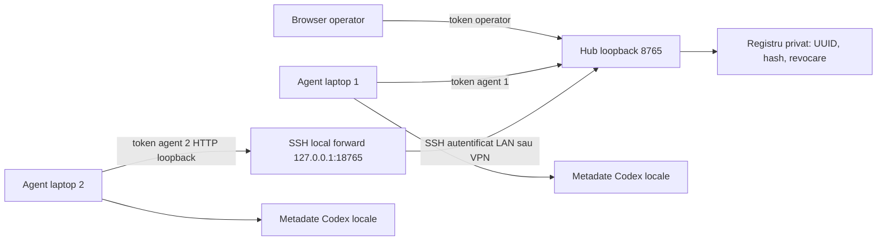

# Etapa 2A — arhitectură și limite

Frontend-ul rămâne HTML/CSS/JavaScript, servit de Hub-ul Node.js pe 127.0.0.1. Agentul Node rulează pe fiecare dispozitiv deținut. Dispozitivele au UUIDv4 aleator și fișier privat de credențiale; hostname-ul este numai o etichetă. Ambele dispozitive pot avea același nume fără să-și suprascrie inventarul.

## Limite de încredere

- Tokenul operatorului permite state, administrarea agenților și fluxul DEMO; nu permite endpointurile agentului.
- Tokenul agentului permite numai heartbeat, preluarea DEMO și rezultatul propriului UUID. Nu permite state, înrolare, revocare, creare/aprobare/respingere a sarcinilor sau raportarea altui UUID.
- Operatorul și agenții au secrete distincte, generate criptografic. Coliziunile cu credențiale existente, inclusiv revocate, sunt refuzate. Tokenurile trebuie protejate și față de utilizatorii locali neautorizați.
- Registrul păstrează numai SHA-256, UUID, nume și date de creare/revocare, în fișier 600 și director 700, cu scriere atomică și lock. Se reîncarcă la autorizare pentru revocare imediată; corupția sau fișierele nesigure blochează autorizarea. Nu șterge registrul pentru a repara o eroare: ai pierde înrolările și evidența revocărilor.
- Fișierul operatorului poate fi rotit local, urmat de restart Hub și reconectarea browserului. Nu există încă UI de rotație. Credențialele agenților se rotesc prin revocare și înrolare nouă.
- HTTP necriptat există numai între procese locale sau la capetele tunelului SSH. Aplicația refuză adrese publice/LAN și redirecturi. SSH trebuie autentificat prin infrastructura existentă; aplicația nu configurează serverul, firewall-ul sau VPN-ul.

## Inventar și confidențialitate

Adaptorul folosește protocolul oficial [Codex App Server](https://learn.chatgpt.com/docs/app-server). Build-ul local verificat este codex-cli 0.163.0. Schema lui include `thread/list.useStateDbOnly`; adaptorul refuză alte versiuni până la validarea lor, pentru a evita ignorarea parametrului și repararea metadatelor prin scanarea transcripturilor.

Sunt permise numai initialize, initialized și thread/list, cu useStateDbOnly=true, sortare după updated_at și maximum 40 rezultate. Nu se folosesc thread/read, thread/resume, thread/start, turn/start, instrumente sau cereri de model. Cererile nesolicitate de tool/aprobare ale serverului sunt refuzate, copilul are deadline/limite de ieșire și este oprit. Mediul copilului nu moștenește cheile API sau tokenurile aplicației. Configurația Codex locală rămâne administrată de operator; adaptorul nu slăbește sandboxul ori aprobările.

Protocolul thread/list include și preview/name în răspuns; nu oferă proiecție pe câmpuri. Acestea pot exista tranzitoriu în memoria procesului Codex/parserului, apoi sunt eliminate. Nu sunt logate, salvate, trimise la Hub sau afișate. Nu se solicită transcripturi/turnuri. Dacă această prezență tranzitorie nu este acceptabilă pentru un dispozitiv, folosește LEVERAGE_SESSION_SOURCE=files.

La Hub ajung exclusiv UUID sesiune, timestamp, sursă și opțional un basename validat al proiectului, fără calea absolută. LEVERAGE_REPORT_PROJECT=0 elimină eticheta proiectului. updatedAt din App Server este ultima activitate cunoscută; mtime din fallback este doar modificarea metadatelor și nu devine ultima activitate confirmată.

Un proces App Server proaspăt nu dovedește că sesiunile altui proces sunt active. Activitatea este deci marcată `discovered`, chiar dacă serverul propriu returnează un runtime status. Hub-ul nu acceptă afirmații de execuție live sau activitate confirmată din heartbeat. Confirmarea activității unui runtime deținut explicit rămâne pentru Etapa 2B.

Fallback-ul citește numai nume de fișiere/stat, fără conținutul JSONL. O eroare/versiune incompatibilă este raportată prin sursă și motiv generic, fără erori private. Metadatele MCP rămân nume configurate, fără credențiale sau verificări live.

## Persistență și lucrări ulterioare

Persistă credențialele și revocările. Inventarul și sarcinile DEMO sunt în memorie; după restart agenții retrimit inventarul. Online înseamnă heartbeat în ultimele 15 secunde, nu sănătatea Codex/MCP. Nu există execuție reală sau audit de execuție persistent.

Etapa 2B necesită propriul control al proceselor/sesiunilor, aprobări tehnice event-driven, autorizare per comandă/dispozitiv, audit persistent și verificări de recuperare. Simplul click Approve DEMO nu autorizează o comandă reală. LEVERAGE_ENABLE_LIVE_CODEX=1 rămâne blocat înaintea validării sarcinii. Nu se implementează 2B în acest branch.
